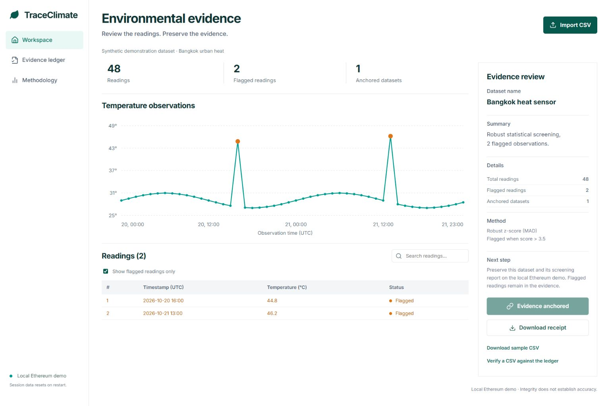

# TraceClimate

**Review the readings. Preserve the evidence.**

Source: https://github.com/veekeancodemaipen/traceclimate



A working environmental-data integrity prototype for the IEEE ClimateChain Global Hackathon. Track: **Climate Data & Environmental Monitoring**.

TraceClimate validates temperature observations, explains unusual readings using robust statistics, and anchors dataset/report fingerprints in a Solidity smart contract on an in-process Ethereum development chain. A second upload can verify whether the normalized dataset matches an anchored record.

## Run locally

Install Node.js 22.12+ (Node 24 LTS recommended), then:

```sh
npm ci
npm run build
npm start
```

Open http://127.0.0.1:4173. No API keys, browser wallet, cloud account or paid services required. The server binds only to the local computer. `npm run dev` serves source through Vite when no `dist` folder exists; after a build, rebuild to see source changes.

```sh
npm test
```

## Demonstration

1. Inspect the built-in synthetic dataset: 48 observations and two injected spikes.
2. Select **Show flagged readings only**. Both spikes remain in the dataset; no evidence is silently discarded.
3. Click **Anchor evidence**. The server sends an actual EVM transaction and waits for its receipt.
4. Open **Evidence ledger** and download the JSON receipt, including transaction hash, block number, contract address and dataset hash.
5. Download the sample CSV and verify it against the ledger: it matches.
6. Change one temperature in a copy of that CSV and verify again: no matching evidence.

The `public/` folder includes the original and changed example CSVs for a reproducible demo.

## CSV contract

```csv
timestamp,temperature_c
2026-10-20T00:00:00Z,29.0
```

Provide 8–5,000 observations, at most 1 MB, unique timezone-qualified ISO timestamps, and finite temperatures from -100 to 100 °C. Extra columns are ignored. Use one sensor and a short window. Only normalized timestamps and temperature values are covered by the dataset fingerprint; filenames, extra columns, site identity and other metadata are not attested.

## Architecture

React/Vite interface → Express API → CSV validation and median/MAD screening → SHA-256 canonicalization → ethers → Ganache EVM → EvidenceRegistry.sol.

- `server/analysis.js`: pure validation, canonicalization and deterministic screening.
- `server/chain.js`: compiles Solidity and deploys the local contract at startup.
- `server/index.js`: analyze, anchor, verify and status endpoints; serves built frontend.
- `contracts/EvidenceRegistry.sol`: reviewer-restricted, duplicate-resistant fingerprint registry.
- `tests/`: input and contract invariants.

`POST /api/analyze`, `/api/anchor`, and `/api/verify` accept `{ "csv": "..." }`. `GET /api/status` returns current chain metadata and receipts. All hashes use SHA-256. The canonical record is `JSON.stringify({schema:'traceclimate.temperature.v1',observations:rows})`, where each row has `timestamp` then `temperature_c`, sorted chronologically. Report field order and algorithm version are fixed in `analysis.js`.

## What this prototype proves

An anchored fingerprint provides a reproducible integrity check inside the running demo. The contract rejects re-anchoring the same normalized dataset and restricts writes to its deploying reviewer. Statistical flags prioritize human review. No carbon credits, emissions reductions or verified sensor measurements are claimed.

## Limitations and production path

- The sample is synthetic and not a real Bangkok sensor deployment.
- Screening uses deterministic robust statistics, not a trained AI model. It can flag legitimate extremes and miss contextual errors. No empirical accuracy claim is made.
- The local Ethereum chain and receipt list are ephemeral: restarting the server resets them. These receipts cannot be checked on a public block explorer.
- One local server controls the reviewer wallet. This is not a decentralized trust system or a production service. The API is intended only for loopback use; do not expose it directly to the internet.
- A hash establishes consistency, not sensor identity, measurement accuracy, or truth. Independent verification against a persistent external chain is future work.
- Production work: durable chain deployment, authenticated reviewer identities, signed sensor provenance, bounded upload concurrency, independent RPC verification, field validation, time-aware anomaly models, and a privacy policy.
- Ganache is a development dependency with legacy transitive packages. Keep this demonstration isolated on loopback; replace the chain runtime for production.

## Submission materials

See `submission/devpost.md`, `submission/demo-script.md`, `submission/checklist.md`, and `design/verification.md`. Screenshots are captured from the running app. A source ZIP is prepared separately and excludes dependency folders and secrets.

## Attribution

Built with React, Vite, Express, ethers, Solidity, Ganache, csv-parse, Lucide icons, and Inter typography (Google Fonts). AI assistance from OpenAI Codex was used for implementation, documentation, testing, and visual concepting. The concept image was generated with OpenAI image generation; the UI is actual HTML/CSS/React, not a screenshot. Synthetic examples were generated for this project. Review and personalize the project story before submitting it under your name.
